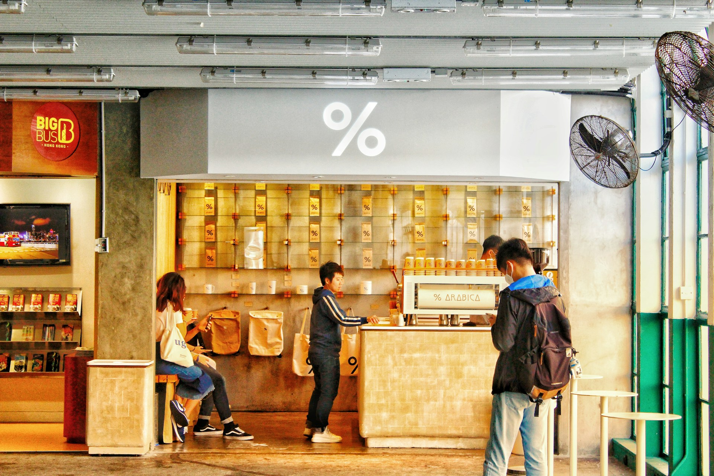

<!-- CATEGORY 1 -->
## LLM
---

  <!-- ITEM 1 -->
  

    <a href="rfm_1.html">
      
      
RFM Analyse

      </a>
      
Wie man mithilfe der RFM-Analyse im Onlinehandel High-Value-Kunden identifiziert

  

<!-- CATEGORY 2 -->
## MLOps
---

  <!-- ITEM 1 -->
  

    <a href="rfm_1.html">
      
      
RFM Analyse

      </a>
      
Wie man mithilfe der RFM-Analyse im Onlinehandel High-Value-Kunden identifiziert

  

<!-- CATEGORY 3 -->
## RAG
---

  <!-- ITEM 1 -->
  

    <a href="rfm_1.html">
      
      
RFM Analyse

      </a>
      
Wie man mithilfe der RFM-Analyse im Onlinehandel High-Value-Kunden identifiziert

  

<!-- CATEGORY 4 -->
## Power BI
---

  <!-- ITEM 1 -->
  

    <a href="rfm_1.html">
      
      
RFM Analyse

      </a>
      
Wie man mithilfe der RFM-Analyse im Onlinehandel High-Value-Kunden identifiziert

  

<!-- CATEGORY 5 -->
## Data Analytics
---

  <!-- ITEM 1 -->
  

    <a href="rfm_1.html">
      
      
RFM Analyse

      </a>
      
Wie man mithilfe der RFM-Analyse im Onlinehandel High-Value-Kunden identifiziert

  

  <!-- ITEM 2 -->
  

    <a href="pareto_1.html">
      
      
Pareto Diagramm

    </a>
      
Pareto trifft E-Commerce: Entlarvt die Datenanalyse den 80/20-Mythos?

  

  <!-- ITEM 3 -->
  

    <a href="recency_1.html">
      
      
Recency Heatmap

    </a>
      
Kundenaktivität verstehen und nutzen – mit Power BI und Recency Heatmap

  

  <!-- ITEM 4 -->
  

    <a href="basket_1.html">
      
      
Basket Analysis

    </a>
      
Warenkorbanalyse im E-Commerce: Was Ihre Kunden wirklich zusammen kaufen

  

  <!-- ITEM 5 -->
  

    <a href="cohort_1.html">
      
      
Cohort Analysis

    </a>
      
Wie lange bleiben Ihre Kunden? Eine datenbasierte Analyse der Kundenbindung

  

